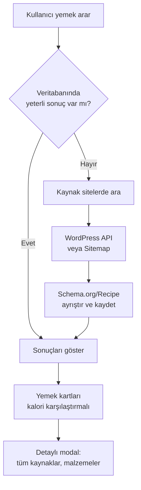

# 🍽️ Calo.com.tr — Tarif Kalori Karşılaştırma Motoru

Aynı yemeğin kalorisini farklı yemek sitelerine göre karşılaştırmanızı sağlayan, tek dosyalı PHP 8.x + SQLite uygulaması.


---

## 📸 Özellikler

- **Kalori Karşılaştırma** — Aynı yemeğin farklı kaynaklardaki kalori değerlerini yan yana görün, yüzde farkını anlık takip edin.
- **Otomatik Tarif Keşfi** — Havuzdaki kaynak siteler üzerinden yemek aratıldığında ilgili tarifleri otomatik bulur ve içe aktarır.
- **Schema.org/Recipe Ayrıştırma** — Tarif sayfalarından JSON-LD yapılandırılmış verisi ayrıştırılarak başlık, malzeme, kalori, süre, zorluk gibi bilgiler çıkarılır.
- **Çift Kalori Kaynağı** — Sitenin kendi yayınladığı kalori değeri varsa (`published`) onu kullanır; yoksa malzeme listesinden yaklaşık hesaplar (`estimated`).
- **WordPress REST API & Sitemap Desteği** — Kaynak sitelerde önce WP API ile arama yapar, yoksa sitemap üzerinden slug eşleştirmesi uygular.
- **TheMealDB Entegrasyonu** — Dış API'den (TheMealDB) farklı dünya mutfaklarından tarifleri toplu içe aktarabilir.
- **Gelişmiş Filtreleme** — Kalori aralığı (çift slider), hazırlama süresi, zorluk, kategori, dil, malzeme dahil/hariç, "sadece elimdeki malzemeler" modu.
- **Kaynak Site Yönetimi** — Yeni site ekleme, otomatik sitemap tarama, başarısız siteleri devre dışı bırakma, tekrar etkinleştirme.
- **robots.txt Uyumlu** — Her site taranmadan önce `robots.txt` kurallarına saygı gösterilir.
- **Responsive Tasarım** — Bootstrap 5.3 ve Font Awesome ile modern, mobil uyumlu arayüz.

---

## 🗂️ Proje Yapısı

```
yemek_arama/
├── index.php              # Tüm backend + frontend (tek dosya mimarisi)
├── recipes_cache.sqlite   # SQLite veritabanı (otomatik oluşur)
├── favicon.ico            # Site ikonu
├── favicon.png            # Site ikonu (PNG)
└── README.md              # Bu dosya
```

---

## ⚙️ Gereksinimler

| Bileşen        | Minimum Sürüm |
| -------------- | -------------- |
| PHP            | 8.0+           |
| SQLite (PDO)   | 3.x            |
| cURL eklentisi | Önerilen       |

> [!NOTE]
> cURL yoksa PHP `file_get_contents` ile çalışır, ancak cURL önerilir.

---

## 🚀 Kurulum

### 1. XAMPP / LAMP / LEMP ile

```bash
# Projeyi htdocs (veya www) klasörüne kopyalayın
cp -r yemek_arama /path/to/htdocs/

# Apache/Nginx'i başlatın
# Tarayıcıda açın:
http://localhost/yemek_arama/
```

### 2. PHP Dahili Sunucusu ile

```bash
cd yemek_arama
php -S localhost:8080
# Tarayıcıda: http://localhost:8080
```

> [!IMPORTANT]
> İlk çalıştırmada `recipes_cache.sqlite` veritabanı ve gerekli tablolar otomatik oluşturulur. Klasörün **yazma izni** olduğundan emin olun.

---

## 🧩 Veri Modeli

### Tablolar

| Tablo       | Açıklama                                          |
| ----------- | ------------------------------------------------- |
| `recipes`   | Tarif kayıtları (başlık, kalori, malzeme, kaynak…) |
| `sites`     | Kaynak site havuzu ve durumları                    |
| `seen`      | Daha önce denenen URL'ler (tekrar çekmeyi önler)   |
| `discovery` | Arama geçmişi ve TTL (tekrar aramayı kontrol eder) |
| `siteurls`  | Sitemap'ten çekilen URL önbelleği                  |
| `siteindex` | Site bazlı sitemap tarama bilgileri                |

### Kalori Veri Tipi

- **`published`** — Tarifin yayınlandığı sitenin kendi besin değeri bilgisi (Schema.org `nutrition.calories`).
- **`estimated`** — Sitenin kalori bilgisi vermediği durumlarda, malzeme listesinden otomatik hesaplanan yaklaşık değer.

---

## 🔍 Nasıl Çalışır?



1. **Arama** — Kullanıcı bir yemek adı girer.
2. **Keşif** — Yetersiz sonuç varsa, havuzdaki aktif sitelere sorgu gönderilir (WP API → Sitemap fallback).
3. **Ayrıştırma** — Bulunan sayfalardaki `application/ld+json` bloklarından `Recipe` düğümleri çıkarılır.
4. **Kalori** — Sitenin kendi değeri yoksa, 100+ malzeme ağırlığı tablosundan porsiyon başına kcal hesaplanır.
5. **Gruplama** — Aynı yemek adına sahip tarifler gruplanarak min/max/ortalama kcal ve yüzde fark gösterilir.
6. **Karşılaştırma** — Modal pencerede tüm kaynaklar, süreler, zorluklar yan yana listelenir.

---

## 📂 Kategoriler

| Emoji | Kategori       | Anahtar Kelimeler                                |
| ----- | -------------- | ------------------------------------------------ |
| 🍲    | Çorba          | çorba, soup                                      |
| 🍖    | Ana Yemek      | (varsayılan)                                     |
| 🍳    | Kahvaltı       | menemen, omlet, börek, simit, poğaça…            |
| 🥗    | Zeytinyağlı    | zeytinyağlı, sarma, dolma, imam bayıldı…         |
| 🍰    | Tatlı          | baklava, künefe, kek, brownie, tiramisu…          |
| 🥑    | Fit & Diyet    | fit, diyet, light, düşük kalori, yulaf…          |
| 🥬    | Salata         | salata, kısır, piyaz                             |
| 🌍    | Dünya Mutfağı  | sushi, taco, curry, ramen, paella, risotto…      |

---

## 🌐 Varsayılan Kaynak Siteler

| Türkçe                      | İngilizce          |
| --------------------------- | ------------------ |
| yemek.com                   | bbcgoodfood.com    |
| kevserinmutfagi.com         | allrecipes.com     |
| pratikyemektarifleri.com    | seriouseats.com    |
|                             | simplyrecipes.com  |
|                             | budgetbytes.com    |

> [!TIP]
> Arayüzdeki "Kaynak Ekle" panelinden yeni siteler eklenebilir. Sitemap'i olan her yemek sitesi desteklenir.

---

## 🔧 Yapılandırma Sabitleri

[`index.php`](file:///d:/xampp/htdocs/projeler/yemek_arama/index.php#L26-L34) dosyasının üst kısmında tanımlı:

| Sabit                   | Varsayılan | Açıklama                                          |
| ----------------------- | ---------- | ------------------------------------------------- |
| `HTTP_TIMEOUT`          | 8          | HTTP istek zaman aşımı (saniye)                   |
| `MAX_IMPORT_PER_REQUEST`| 12         | Tek istekte en fazla içe aktarılan tarif           |
| `DISCOVER_LIMIT`        | 6          | Keşif başına en fazla yeni tarif                   |
| `DISCOVER_TTL_DAYS`     | 7          | Aynı yemek tekrar aranmadan beklenecek gün        |
| `MIN_SOURCES_PER_DISH`  | 3          | Keşfin tetikleneceği minimum kaynak sayısı         |
| `SITE_FAIL_LIMIT`       | 3          | Ardışık başarısız denemeden sonra site devre dışı  |
| `SITEMAP_URL_CAP`       | 2500       | Site başına önbelleklenen maksimum URL              |
| `AUTO_TOPUP_TARGET`     | 40         | TheMealDB'den otomatik doldurma hedefi             |

---

## 🛡️ Güvenlik ve Etik

- **robots.txt Uyumu** — Her site taranmadan önce `robots.txt` kontrol edilir; yasaklanan yollar atlanır.
- **User-Agent Beyanı** — Tüm istekler `CaloComTr/3.0 (recipe calorie comparison; respects robots.txt)` olarak tanıtılır.
- **Rate Limiting** — Her istekte en fazla `DISCOVER_LIMIT` tarif çekilir; TTL ile tekrar arama sınırlandırılır.
- **XSS Koruması** — Tüm kullanıcı girdileri `htmlspecialchars` ile temizlenir.
- **Kaynak Atfı** — Her tarif, orijinal sayfasına doğrudan bağlantı verir; içerik kopyalanmaz.

---

## 📋 Kullanım Kılavuzu

### Yemek Arama
Ana sayfadaki arama kutusuna yemek adı, malzeme veya kategori yazıp **"Karşılaştır"** butonuna tıklayın.

### Filtreleme
Sol panelden:
- 🎚️ Kalori aralığını çift slider ile ayarlayın
- ⏱️ Maksimum hazırlama süresini belirleyin
- 📊 Zorluk seviyesini seçin (Kolay / Orta / Zor)
- 🥕 Olmasını istediğiniz malzemeleri virgülle girin
- 🚫 İstemediğiniz malzemeleri belirtin
- 🔄 "Sadece elimdeki malzemeler" modunu açın

### Kalori Karşılaştırma
Yemek kartındaki **"Kalorileri karşılaştır"** butonuna tıklayarak tüm kaynakları, sürelerini ve malzeme listelerini detaylı görün.

### Kaynak Site Ekleme
"Kaynak siteler" panelinden yeni bir yemek sitesinin adresini girerek ekleyin. Sitemap otomatik taranır ve ilk tarifler içe aktarılır.

---

## 🧰 Teknolojiler

| Katman    | Teknoloji                                                                 |
| --------- | ------------------------------------------------------------------------- |
| Backend   | PHP 8.x (tek dosya, framework bağımsız)                                   |
| Veritabanı| SQLite 3 (PDO, WAL modu)                                                 |
| Frontend  | Bootstrap 5.3, Font Awesome 6.5, Vanilla JavaScript                       |
| Veri       | Schema.org/Recipe (JSON-LD), WordPress REST API, TheMealDB API           |
| HTTP      | cURL / `file_get_contents` fallback                                       |

---

## 📜 Lisans

Bu proje açık kaynaklıdır. Tüm tarifler ve kalori bilgileri kaynak sitelerine aittir.

> [!CAUTION]
> Kalori bilgileri yalnızca karşılaştırma amaçlıdır, tıbbi tavsiye niteliği taşımaz.

